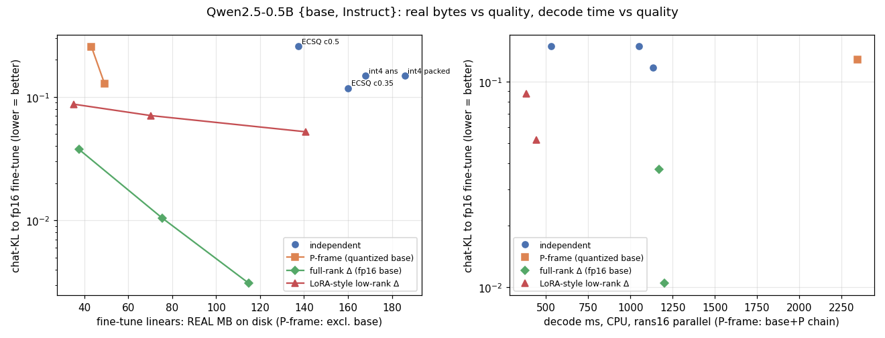
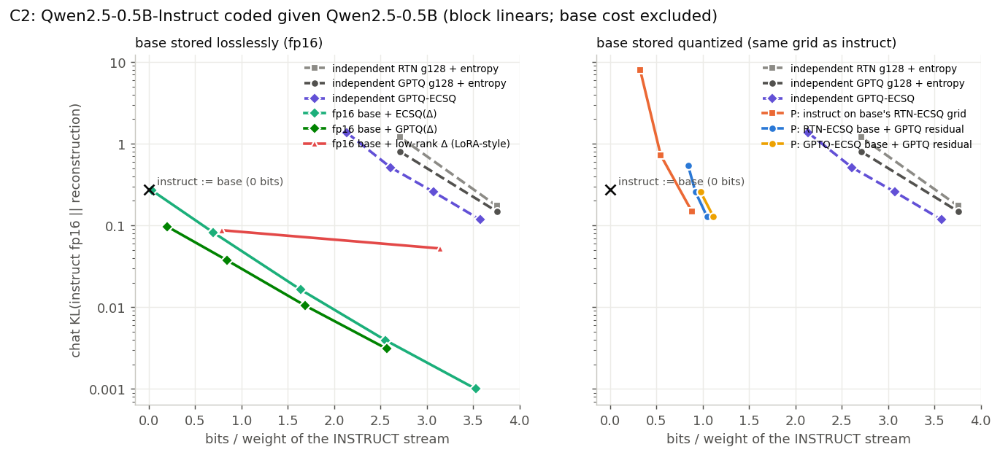
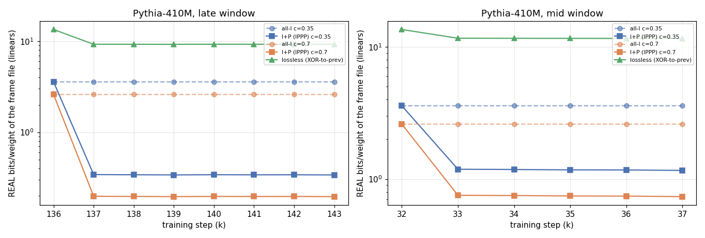
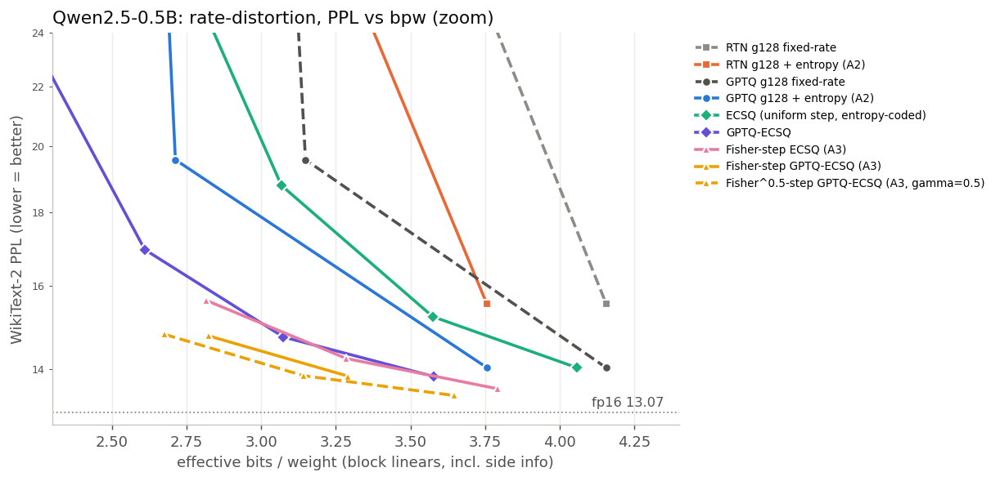
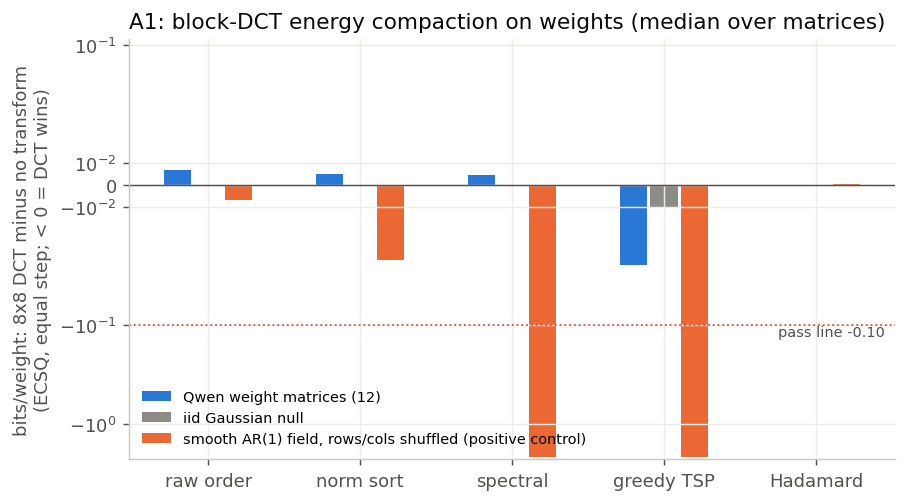
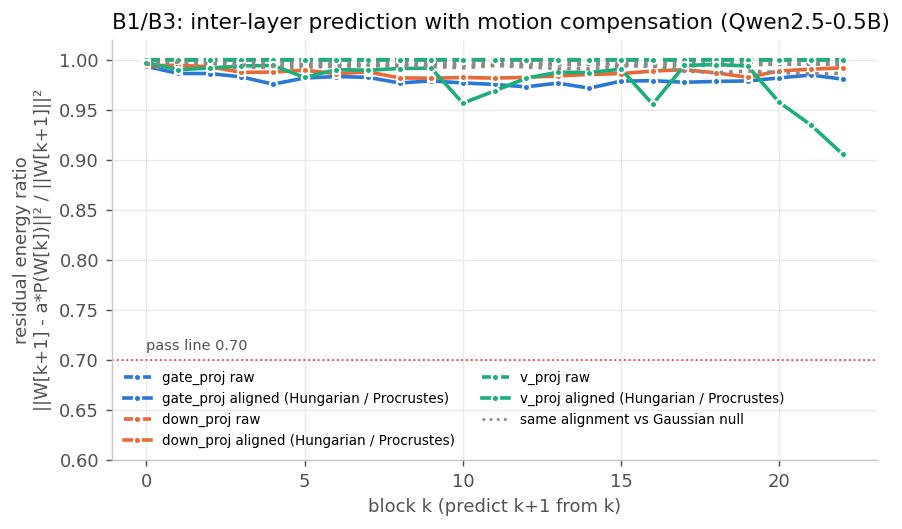

# weight-codec

**Can neural-network weights be compressed like images (JPEG, *intra*) — and model families or
training checkpoints like video (*inter-frame* prediction)?**

**In plain terms — where the compression comes from.** Not a clever trick on a single model, but the fact that
*related models are almost identical.* A fine-tune (an Instruct / chat version, say) differs from its base model by
only ~7–8 % of its weights; consecutive training checkpoints differ even less. So you store **one** model in full and
keep only the small **difference** for each relative, then pack those differences with an entropy coder (ZIP-like).
If you already have the base, a fine-tune then costs several times less than storing it whole, and a run's checkpoints
compress like video frames. Compressing a *single* standalone model, by contrast, buys little beyond ordinary
rounding (quantization): treating a weight matrix like a JPEG image fails outright — weights look like random noise,
with no smooth structure for a frequency transform to exploit. **The win is "store one, diff the rest", not magic on
one model** — and, surprisingly, the difference is best left full-rank and entropy-coded rather than squeezed into a
low-rank (LoRA-style) form.

This repository is a falsification-first study of that analogy on real ≤ 1 GB language models
(Qwen2.5-0.5B family, SmolLM2-135M/360M, Pythia-410M training checkpoints), plus a working
bitstream codec (`wcodec/`) that turns the surviving ideas into real files and measures their decode cost.

* Every hypothesis got a cheap **probe with a pre-registered pass line** (written in the script docstring)
  *before* any codec was built. Codecs were built only for the survivors.
* Distortion is always measured **downstream** (perplexity, KL to the original model, chat-KL on the
  fine-tune's own answers), never as weight-MSE.
* Phase 1 estimated rates with an entropy proxy; phase 2 wrote **real files** (every header / table / scale
  byte counted) and evaluated models **decoded from those files**.
* Negative results are reported with the same care as positive ones — half of the analogy is dead.

Full write-up with every number, caveat and process deviation: **[REPORT.md](REPORT.md)**.
Raw numbers: `results/*.json`, `results/phase2_tables.md`. Figures: `figures/`.

> Status: research code, not a library or a production format. Small models, one machine, single seed —
> read [Limitations](#limitations) before quoting numbers.

## Browser demo

**Base once + entropy-coded delta → SmolLM2-135M-Instruct, rebuilt in your browser** ([live page](https://lifeart.github.io/weight-codec/),
also on the [Hugging Face Space](https://huggingface.co/spaces/lifeart/weight-codec); source in [`docs/`](docs/)): the page
downloads the compressed `.wcdc` files, rANS-decodes them in plain JavaScript (Web Worker), rebuilds the fp16 weights,
checks **SHA-256 against the Python decoder** (and, for lossless parts, against the original checkpoint), then
**generates text with the rebuilt weights** through a ~130-line JavaScript Llama forward pass. Base files stay in the
browser's Cache Storage, so they are downloaded once. The files use the codec's **default coders** (REPORT §17):
quantization steps set per output row *and per input column* (Fisher-weighted for the base I-frame, Hessian-weighted for
the delta) — the same container, one extra fp16 section per tensor.

| configuration | base (cached once) | Instruct delta | rebuilt Instruct vs original | previous coder (row grid, §14) |
|---|---|---|---|---|
| fp16 base (lossless) + full-rank Δ, column grid c=1.6 | 178.1 MB | **51.8 MB** | chat-KL **0.012**, top-1 96.2 % (lossy linears; embeddings/norms bit-exact) | 53.4 MB → chat-KL 0.030 |
| int4-class Fisher-grid base I-frame + Instruct P-frame | 86.3 MB | **43.9 MB** | chat-KL **0.084**, top-1 88.2 % — smallest; still below the original on this small model | 85.3 + 45.4 MB → chat-KL 0.54 |
| control: standalone Instruct (same coder), no base reuse | — | 86.3 MB | chat-KL 0.095 | 85.3 MB → 0.50 |

For scale: the official Instruct checkpoint is 269.1 MB (bf16), a standard GPTQ-int4 g64 file 113.9 MB (chat-KL 0.40);
storing **both** models as the family pair takes 130.1 MB vs 227.9 MB for two int4 files (−43 %) at 4.8× lower chat-KL.
Verified offline before every deploy: `node phase2/test_demo.mjs` (every file decodes bit-exactly like the Python decoder,
lossless parts are identical to the checkpoint, the JS forward pass reproduces PyTorch's greedy tokens on the rebuilt
weights), `phase2/test_codec_js.py` (JS vs Python on synthetic row- and column-grid files incl. malformed ones),
`phase2/seam_fields.py` (every field the page reads exists in what the build wrote) and `phase2/test_page_cdp.mjs` (the
real page in headless Chromium: decode → verify → generate). Live decode takes ≈ 5–10 s and generation ≈ 5 tokens/s on
one JS thread. The page labels live vs precomputed output and lossless vs approximate weights explicitly.

**Data.** The bitstreams (≈ 380 MB, rans16 re-encodes of the measured files + a new lossless base-linears file) and the
official `tokenizer.json` are **not in git**. `phase2/demo_build.py` writes them to `docs/bitstreams/` (git-ignored)
together with the committed `docs/data/*.json` (manifest with expected digests, precomputed answers, numbers).
The page fetches them from `config.js → dataBase` (default: `bitstreams/` next to the page; a `?data=<url>` query
parameter overrides it). Without reachable data the page says so and still shows the numbers and precomputed answers.

```bash
.venv/bin/python phase2/demo_build.py          # bitstreams + manifest + precomputed answers (~5 min, downloads both checkpoints)
node phase2/test_demo.mjs                      # end-to-end check of the page's JS (decode, SHA-256, tokenizer, generation)
cd docs && python3 -m http.server 8000         # local preview: http://localhost:8000 (needs localhost/https for WebCrypto)
```

* **Hugging Face static Space** (hosts page + bitstreams): `.venv/bin/python phase2/deploy_static_space.py` stages
  `docs/` + `docs/bitstreams/` + the Space card (`spaces/weight-codec-static/README.md`) into `build/space/` and checks
  the staged text for hardware / infrastructure details; `--deploy` uploads it to `WC_SPACE` (a new Space is created
  private; updating an already public Space needs `--public-ok`).
* **GitHub Pages** (page only): *Settings → Pages → Deploy from a branch → `<branch>` / `docs`*. Pages cannot serve the
  bitstreams from git, so set `dataBase` in `docs/config.js` to a public host with CORS — e.g. the Space once it is public,
  `https://huggingface.co/spaces/<user>/<space>/resolve/main/bitstreams/`, or a public HF dataset/model repo
  (`https://huggingface.co/datasets/<user>/<repo>/resolve/main/`). Hugging Face `resolve` URLs send CORS headers.

## TL;DR

| hypothesis | verdict on these models | headline number |
|---|---|---|
| JPEG **transform** (block-DCT, ± row/column reordering, Hadamard) | **falsified** | DCT changes rate by **+0.007 bit/weight** (positive control: −2.17) |
| JPEG **quantizer + entropy coder** (uniform-step ECSQ, entropy-coded) | confirmed | GPTQ-int4 quality at **3.47 bpw** instead of 4.16 |
| JPEG **perceptual weighting** (Fisher-sensitivity step sizes) | confirmed | GPTQ-int4 quality at **3.05 bpw (−27 %)**; ranking holds out of domain (C4) with a smaller margin |
| **layers as frames** (+ neuron-permutation / rotation "motion compensation") | **falsified** | adjacent-layer residual 0.986 after alignment vs 0.996 for a random null → ≈ 0.01 bit/weight |
| **model family as a GOP** (instruct fine-tune as a P-frame of its base) | **confirmed — largest win** | pair {base, Instruct} on disk: **−42 % / −44 % / −43 %** vs two standard GPTQ-int4 files (Qwen2.5-0.5B / SmolLM2-360M / SmolLM2-135M) |
| **per-column step sizes** (Fisher-weighted base I-frame, rounding P-frame on its lattice, Hessian-column Δ) — the codec's **default** since REPORT §17 | confirmed on 3 models, real files | same pair size, fine-tune chat-KL **2.2× / 2.9× / 6.4× lower** (Qwen / SmolLM2-360M / -135M); fine-tune Δ file **−19…−35 %** at equal chat-KL |
| fine-tune Δ is **low-rank (LoRA-like)** | **falsified** | entropy-coded full-rank Δ gives **2–25× lower chat-KL** than a LoRA-style Δ at equal or fewer real bytes |
| continued-pretraining relatives (Qwen2.5-Coder) as P-frames | **mostly falsified** | P/I = 0.96 in real bytes ("scene cut") |
| **training checkpoints as video** (Pythia-410M) | confirmed late in training | 8-checkpoint GOP: **224.7 MB vs 1081 MB all-I (−79 %)**; mid-training −56 %; no drift |
| one **progressive (SVC) stream** | confirmed with nested quantizers | ×3 nested lattice + context coding: **+0.15 % / +0.40 %** bytes over single-shot files |
| entropy-coded weights are cheap to decode | **not free** | 0.5 B model: 7–9 s with an off-the-shelf rANS (1 thread) → **1.1 s** (own rANS, 8 cores) / **0.6 s** (Metal GPU) vs 0.55 s int4 unpack |

Bottom line: the *video* half of the analogy works where real temporal redundancy exists — between a base model
and its fine-tunes, and between nearby training checkpoints — and the "motion" is trivial (identity alignment).
The *JPEG* half works only through its quantizer, entropy coder and sensitivity weighting; the transform, the heart
of JPEG, has nothing to compact. Inside a single model there was no spatial or inter-layer redundancy to exploit.

## Main results

All numbers below are from real `.wcdc` files (phase 2) unless marked; quality is measured on the decoded model.
"chat-KL" = KL(original fp16 fine-tune ‖ reconstruction) on the fine-tune's own greedy answers to 48 fixed prompts.

### 1. A model family stored as I-frame + P-frame

Qwen2.5-0.5B + Qwen2.5-0.5B-Instruct, **every tensor of both models on disk**:

| how the pair is stored | pair MB | base PPL | Instruct chat-KL |
|---|---|---|---|
| both fp16 | 1976 | 13.07 | 0 |
| two standard GPTQ-int4 g128 files (rest fp16) | 917 | 14.03 | 0.148 |
| both GPTQ-int4 + rANS, rest lossless | 694 | 14.03 | 0.148 |
| both independent GPTQ-ECSQ c=0.35, rest lossless | 678 | 13.84 | 0.117 |
| family: base I-frame + Instruct P-frame + XOR-coded rest (phase 2, row grid) | 532 | 13.84 | 0.128 |
| **family, default coders since §17: Fisher-grid I-frame + rounding P-frame on its lattice** | **530** | **13.42** | **0.059** |

Same pattern on SmolLM2-360M (**294 MB** family at chat-KL 0.048 — phase 2: 295 MB at 0.138 — vs 528 MB for two int4
files at 0.118) and SmolLM2-135M (130 MB at 0.084 — phase 2: 131 MB at 0.538 — vs 228 MB at 0.400). With the default
coders the c = 0.5 pair is 6–9 % smaller than the phase-2 c = 0.35 pair and still better on base KL and chat-KL
(REPORT §17.2). The Instruct P-frame of all 168 Qwen linears is **49.2 MB (1.10 bpw)**; the gain on whole
files is smaller than on linears alone (−35 %) because embeddings were coded *losslessly* in all full-file numbers.



### 2. A full fine-tune's Δ is small but *not* low-rank

‖Δ‖/‖W‖ ≈ 0.08 for base → Instruct, but the energy is spread over the whole spectrum (90 % energy needs ≈ 67 %
of the rank). Coding the full-rank Δ with GPTQ on an entropy-coded uniform grid beats a LoRA-style truncation at
matched bytes (fp16 base available losslessly):

| family | Δ vs LoRA-style r at ≈ the same MB → chat-KL ratio |
|---|---|
| Qwen2.5-0.5B | **2.3×** (37.7 vs 35.2 MB), **6.7×** (75.4 vs 70.4 MB), **17×** (114.9 vs 140.8 MB) |
| SmolLM2-135M | **2.2×** at 59 % of the bytes, **14×** at 88 %, **7×** at 44 % |
| SmolLM2-360M | **2.8×** at 88 %, **10.8×** at 91 %, **25.2×** at 70 % |

Qwen2.5-0.5B-Instruct at 1.69 bpw as a Δ (75.4 MB for all linears) reaches chat-KL 0.011 — 14× lower than a
standalone GPTQ-int4 copy (3.76 bpw → 0.148). The default Δ coder since REPORT §17 (per-column Hessian steps, plain
rounding) does better again: 70.5 MB → chat-KL 0.007, and the Δ file is 19–35 % smaller at equal chat-KL on all three
families. Not tested: adapters that were *trained* as LoRA (there the low-rank
structure exists by construction).



### 3. Training checkpoints as video (Pythia-410M)

Consecutive 1000-step checkpoints, closed-loop P-frames on the I-frame's lattice (encoded off-Mac on a
Hugging Face Job, x86; decoded bit-exactly on Apple Silicon, sha256-checked on CPU and GPU):

| window | all-I GOP (linears) | I + P… GOP | P-frame size |
|---|---|---|---|
| late, steps 136k–143k (8 frames), int4-class | 1081.2 MB | **224.7 MB (−79 %)** | 0.339 bpw = 9.5 % of an I-frame |
| mid, steps 32k–37k (6 frames), int4-class | 811.0 MB | **357.0 MB (−56 %)** | 1.176 bpw = 33 % of an I-frame |
| lossless archive (XOR with previous) | 13.53 bit/weight | **9.31 bit/weight** (late) | |

With an integer decoder state the end of the P-chain is *bit-identical* to quantizing the last checkpoint directly
— no drift by construction. The P-frame cost tracks the learning-rate schedule.



### 4. Inside one model: only the quantizer and the entropy coder help

On Qwen2.5-0.5B (block linears; PPL on WikiText-2): uniform-step quantization without clipping + entropy coding
(ECSQ), GPTQ run on that grid, and Fisher-sensitivity step sizes reach GPTQ-int4 g128 quality (PPL 14.03) at
**3.05 bpw instead of 4.16**. Out of domain (C4) the ranking survives, the Fisher gain shrinks to ≈ 0.3–0.4 bpw.
A real rANS file matches the entropy estimate to ±0.02 %.



### 5. Decode cost is real

Time to rebuild the fp16 linears of Qwen2.5-0.5B-Instruct (357.8 M weights) from the file(s), warm page cache,
an Apple Silicon laptop (8 CPU cores + Metal GPU):

| format | MB | constriction rANS, 1 thread | own `rans16`, 8 threads | Metal GPU |
|---|---|---|---|---|
| GPTQ-int4 packed (no entropy decode) | 185.9 | 0.58 s (unpack + dequant) | — | 0.55 s |
| GPTQ-ECSQ c=0.35 | 160.1 | 9.16 s | 1.13 s | 0.62 s |
| base I-frame + Instruct P-frame (chain) | 209.2 | 15.35 s | 2.34 s | **0.96 s** |
| Instruct P-frame only (base cached) | 49.2 | 6.19 s | 1.11 s | **0.43 s** |
| fp16 safetensors (whole model) | 988.1 | 0.13 s load | | 0.25 s to GPU |

A generic coder (zstd-19) is within 1–3 % of rANS on int4-class I-frames and decodes much faster, but costs
**+6–23 %** on the low-entropy P-frame / Δ streams — exactly where the family codec earns its gain. Below
≈ 1 Gbit/s download speed the bytes dominate and the family/Δ streams win; at LAN speeds a parallel or GPU
entropy decoder is required.

## What was falsified

* **The transform.** An 8×8 DCT on weight matrices does not compact energy (+0.007 bit/weight, i.e. slightly
  *harmful*; it spreads heavy-tailed outliers). Reordering rows/columns (norm sort, spectral, greedy TSP) cannot
  manufacture smoothness (best ≈ 0.03 bit/weight over a random null), while the same pipeline recovers −2.1 bit on a
  shuffled smooth positive control. No DCT codec was built.
  
* **Layers as frames.** Same-named matrices of adjacent blocks have |cos| ≤ 0.044; after exact
  "motion compensation" (Hungarian permutation of MLP neurons, Procrustes rotations for V/O) the residual is
  0.986 of the energy, vs 0.996 when the same alignment is fitted to a Gaussian matrix. Pass line was 0.70.
  
* **"The fine-tune delta is LoRA-like."** Full SFT+RL deltas are full-rank, small-amplitude perturbations
  (training-checkpoint deltas are low-rank only very early in training, before ~1–2 k steps).
* **"Same architecture + same init ⇒ cheap P-frame."** Qwen2.5-Coder-0.5B is as far from Qwen2.5-0.5B
  (‖Δ‖/‖W‖ 0.88) as distant training checkpoints; as a P-frame it saves only 3.6 % in real bytes (P/I 0.964; 8.6 % with per-row prediction gains in the phase-1
  estimate) — a scene cut, not a P-frame.

## Where it is useful — and where it is not

Plausibly useful (interpretation, based on the measurements above):

* **Model hubs / registries** that store many full fine-tunes of one base: one base I-frame + sub-1.1-bpw P-frames
  or Δ-streams, with random access per tensor (star topology = one extra decode).
* **Delivering a fine-tune to a client that already has the base**: Qwen2.5-0.5B-Instruct as P-frame + XOR rest is
  193 MB (vs 458 MB standard int4 file, 988 MB fp16); as an fp16-base Δ it is 219 MB at chat-KL 0.0105.
* **Training-checkpoint archives**: −56…−79 % lossy (int4-class), −31 % lossless late in training.

Not useful / not shown:

* As a **runtime inference format**: variable-length codes are not a drop-in for int4 GEMM kernels; this is a
  storage / transport codec that decodes to a fixed-width or fp16 buffer at load time.
* Embeddings were stored **losslessly** in all full-file numbers (for Qwen they are 3× larger than the Instruct
  P-frame of all linears); lossy embedding coding was not evaluated.
* Continued-pretraining relatives, layer-to-layer prediction and transform coding gave (almost) nothing.

## Limitations

* Small models only (135 M – 0.5 B parameters), one main family (Qwen2.5-0.5B, which is very
  quantization-sensitive), one checkpoint series (Pythia-410M). Numbers will move on larger / more robust models.
* Single seed, no confidence intervals; KL on 16 WikiText windows (32 k tokens) and a 48-prompt chat set.
* GPTQ is the non-sequential variant without act-order or clipping search; stronger int4 baselines
  (AWQ, OmniQuant, QuIP#…) would narrow the intra-model results, not the family / checkpoint results
  (those are relative to the same quantizer).
* Calibration (GPTQ Hessians, Fisher) on WikiText-2 train, evaluation on WikiText-2 test; an out-of-domain C4
  check is included (REPORT §8). Instruct models were not chat-calibrated.
* Evaluation in fp16 on Apple MPS (checked against fp32 to 1e-5 PPL); decode timings are warm-page-cache numbers
  on one machine; download times are modelled from MB, not measured. GPU decoder is Metal-only (no CUDA build).

## Future work

**Does the delivery win extend to runtime? (lazy / progressive, usage-dependent decode.)** The gain splits.
*Quantization* (fixed-length) carries into runtime as a **bandwidth** win — keep weights compressed in memory and
fuse dequant into the matmul kernel, as int4 kernels already do. *Entropy coding* (the variable-length part that gives
our extra delta compression) mostly does **not**: random access into a variable-length stream is hostile to a parallel
matmul, so it stays a delivery/storage win. Lazy, usage-dependent decode pays only under **conditional compute** — MoE
(decode only the active experts), contextual sparsity (only active neurons), early-exit (only the layers used), or
multi-tenant serving (a shared base resident in memory + a small per-variant Δ applied per layer on the fly). In a dense
single model every matmul touches all weights each token, so only *precision* laziness helps there.

The JPEG 2000 analogy maps cleanly to three runtime knobs: **quality/SNR → nested fixed precision** (any-precision /
bit-serial, spend bits per token); **resolution → progressive rank** (an SVD base for a cheap approximate matmul, refined
on demand); **ROI / code-blocks → independently-coded weight blocks** for random access — with the core JPEG 2000 trade-off
intact: *random access ⟺ independent blocks ⟺ slightly worse compression*. A runtime-friendly form is therefore nested
*fixed* precision plus block random access, not full entropy coding. A sharper note on our own result: a full-rank
entropy-coded Δ is best for **delivery** but costs a full-size add per layer at runtime, whereas a low-rank (LoRA-shaped)
Δ is cheaper at runtime but worse on disk — so our win reaches runtime most in multi-tenant serving.

Testable on ≤1 GB models, in the same style as phase 1: (1) the bpw penalty of block-independent coding; (2) the active-neuron
fraction per token (contextual sparsity) on Qwen / SmolLM; (3) progressive-rank matmul error vs rank; (4) quality per level
of nested fixed precision. Other open threads: lossy-compress the embeddings (still lossless here), a fused decode+dequant
GPU kernel, a WASM SIMD decoder, and a zstd-for-I-frames / rANS-for-P-frames hybrid.

## Reproduce

Tested with Python 3.11 on macOS (an Apple Silicon laptop, PyTorch MPS) and, for the phase-2 jobs, x86-64 Linux CPU.
Device selection is MPS → CPU; there is no CUDA path. CPU-only evaluation works but is 10–15× slower.

```bash
python3.11 -m venv .venv
.venv/bin/pip install -r requirements.txt
export HF_HUB_DISABLE_TELEMETRY=1
```

Models and data are public and pulled from the Hugging Face Hub on first use (no token needed):
`Qwen/Qwen2.5-0.5B`, `-Instruct`, `Qwen/Qwen2.5-Coder-0.5B`, `-Coder-0.5B-Instruct`,
`HuggingFaceTB/SmolLM2-135M`/`-Instruct`, `HuggingFaceTB/SmolLM2-360M`/`-Instruct`,
`EleutherAI/pythia-410m` at revisions `step*` (streamed into RAM, not written to disk),
`Salesforce/wikitext` (`wikitext-2-raw-v1`), one `allenai/c4` validation shard. No weights or datasets are
redistributed in this repository.

**Phase 1 — probes and estimated-rate codecs** (many hours on an Apple Silicon laptop; strictly sequential; every script is resumable):

```bash
scripts/run_all.sh                  # sanity → spine → probes A1/B1/C1/C3/D1/A3 → codecs C2/A3/E/D2 → C4 check → figures
```

`scripts/run_all.sh` lists the individual commands in order (each line can be run on its own);
the pre-registered pass lines are in the probe docstrings, the protocol in REPORT §1. Scripts stop themselves when free disk runs low (`check_disk` in `scripts/common.py`).

**Phase 2 — real bitstreams, decode benchmark** (local part):

```bash
.venv/bin/python phase2/test_wcodec.py cpu    # bit-exact round trip of every record kind
phase2/run_phase2_local.sh                    # family codec ×3, SVC, scene cut, decode bench, zstd reference, tables, figures
```

`phase2/run_phase2_local.sh` reproduces phase 2 with the phase-2 coders (`family_codec.py --preset phase2`). Since
REPORT §17 the family codec's **default** coders are the Fisher-grid I-frame + rounding P-frame on its lattice and the
rounding column-grid Δ; the §17 re-measurement of one pair (baseline files reused from the phase-2 run):

```bash
.venv/bin/python phase2/family_codec.py --base HuggingFaceTB/SmolLM2-135M --target HuggingFaceTB/SmolLM2-135M-Instruct \
    --tag smol135 --tok_tag smollm2 --ref_base smol135 --ref_target smol135_instruct --group 64 \
    --store default_family_smol135 --no_baseline --pframe gptq --pframe_round_cs 0.35,0.5   # both P-frame quantizers
.venv/bin/python phase2/ghcol_roundtrip.py --coders default      # SHA-256 round trip on all 5 decoder paths
.venv/bin/python phase2/default_headline.py                      # before / after tables -> results/default_headline.json
```

**Phase 2 — off-machine runs on Hugging Face Jobs (optional, paid CPU).** `phase2/hf_job.py` ships the code as a
base64 tarball in an environment variable, runs the unit tests and the script on a CPU job
(`<cpu-flavor>` = any HF Jobs CPU hardware flavor; the Pythia run used 8 vCPU / 32 GB), and uploads results
and bitstreams incrementally to a dataset repo. Set `WC_REPO` to a dataset repo **you own** (the default is the
author's private repo); the HF token is passed only through the Jobs secrets mechanism.

```bash
export WC_REPO=<your-user>/weight-codec-runs
.venv/bin/python phase2/hf_job.py pythia410m_traj_v2 <cpu-flavor> 4h phase2/trajectory_codec.py \
    --repo EleutherAI/pythia-410m --tag pythia410m --windows late,mid --dtype fp32 --no_ppl
.venv/bin/python phase2/job_status.py <job_id> 20     # status + last log lines
.venv/bin/python phase2/xcheck_trajectory.py          # decode the job's x86-encoded files locally, compare sha256
```

**Demo Space.** See [Browser demo](#browser-demo): `phase2/demo_build.py` builds the data, `phase2/deploy_static_space.py --deploy`
stages `docs/` + bitstreams and uploads them to `WC_SPACE` (created **private**; updating a public Space needs `--public-ok`).
`spaces/weight-codec-demo/` is a Gradio variant (rebuild the fine-tune from the bitstreams and generate); it requires
paid Space hardware (HTTP 402 otherwise).

Disk: `data/` (tokenized eval sets, reference hidden states, Fisher statistics) grows to ≈ 0.4 GB, `bitstreams/` and the
Hugging Face model cache to several GB during phase 2; all of it is git-ignored. Run one heavy model process at a time.

## Repository layout

```
REPORT.md                 full report: protocol, every table, FACT vs INTERPRETATION, deviations (§12, §14.9)
results/                  raw numbers (json/csv/md) behind every table; phase2_tables.md = phase-2 tables
figures/                  all plots used in REPORT/README
scripts/                  phase 1: common.py (eval, GPTQ/ECSQ, entropy accounting), probes, codecs, plots, run_all.sh
wcodec/                   phase 2 codec: WCDC container, rANS (constriction), own rans16 (numba CPU + Metal GPU),
                          lossless fp16 coder, quantizers, record kinds (raw16/ll16/qrow/g128/lowrank)
phase2/                   phase 2 runners: family / trajectory / SVC / scene-cut / decode bench / zstd reference,
                          HF Jobs launcher, Space staging, tests (test_wcodec.py), run_phase2_local.sh
docs/                     browser demo (GitHub Pages / static Space): index.html, app.js, js/{codec,tokenizer,llama,worker}.js,
                          data/*.json (manifest + digests, precomputed answers, numbers); bitstreams/ is built, not committed
spaces/weight-codec-static/   Space card (README.md) of the static Space that serves docs/ + bitstreams
spaces/weight-codec-demo/     Gradio Space app (rebuild + generate)
```

## Demo and data (author's Hugging Face resources)

* Static demo Space: <https://huggingface.co/spaces/lifeart/weight-codec> (public; serves the page and the bitstreams);
  the same page on GitHub Pages: <https://lifeart.github.io/weight-codec/>.
* Job results and bitstreams: dataset `lifeart/weight-codec-phase2` — **private**.

Everything needed to regenerate both is in this repository.

## Citation

If you use the code or the results, please cite:

```bibtex
@misc{kanunnikov2026weightcodec,
  author       = {Kanunnikov, Aleksandr},
  title        = {weight-codec: compressing neural-network weights like images and video -- a falsification-first study},
  year         = {2026},
  howpublished = {\url{https://github.com/lifeart/weight-codec}},
  note         = {Code, results and report}
}
```

(also in [`CITATION.cff`](CITATION.cff)).

## Credits and license

Author: **Aleksandr Kanunnikov** ([lifeart](https://github.com/lifeart)). The experiments were designed, run and written
up with Claude Code agents (Anthropic's Claude) under the author's direction; commits carry a `Co-Authored-By` trailer.

Entropy coding uses [constriction](https://github.com/bamler-lab/constriction); models and datasets are fetched from
the Hugging Face Hub under their own licenses.

Code and documentation: [MIT License](LICENSE).
